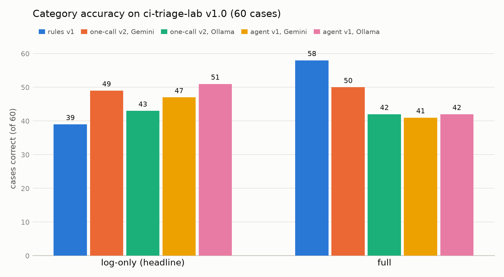

# ci-triage-agent

An agent that triages failing GitHub Actions runs. It is developed and evaluated
offline against [ci-triage-lab](https://github.com/Yassine-Elkesraoui/ci-triage-lab),
pinned at v1.0 as the `lab/` submodule: 60 labelled CI failures in 6 categories.

Status: milestones D1 (scaffold), D2 (replay layer), D3 (tools), D4 (diagnosis format and evaluation
harness), D5a (a rules-only baseline, committed before its first evaluation), D5b (its first score, in
`reports/`), D5c (the log-only evaluation mode), D6a (a one-call LLM baseline, scored in `reports/`),
grader v2 (`reports/grader-v2-regrade.md`), D6b (a tool-using agent, scored in `reports/`) and D7 (the
consolidated results, `reports/d7-summary.md`, tagged `results-v1`). Tests need no network and no keys.

## Results

Five predictors on the 60 lab cases, graded with grader v2.1. **Log-only** (no diff available) is the
headline condition; **full** mode adds the diff from the last green run. The LLM predictors run on
`gemini-3.5-flash-lite` (hosted) and `qwen3.5:4b` (local, Ollama). Each is a single run at temperature 0.

| predictor | log-only accuracy | log-only macro-F1 | full accuracy | full macro-F1 |
|---|---|---|---|---|
| rules v1 (no LLM) | 39/60 (65.0%) | 0.593 | **58/60 (96.7%)** | **0.966** |
| one-call v2, Gemini | 49/60 (81.7%) | 0.783 | 50/60 (83.3%) | 0.799 |
| one-call v2, Ollama | 43/60 (71.7%) | 0.683 | 42/60 (70.0%) | 0.664 |
| agent v1, Gemini | 47/60 (78.3%) | 0.781 | 41/60 (68.3%) | 0.698 |
| agent v1, Ollama | **51/60 (85.0%)** | **0.843** | 42/60 (70.0%) | 0.690 |



- Without a diff, the LLMs beat the rules. The small local model with tools is best: 51/60 against 39/60
  (exact McNemar p = 0.004).
- With the diff, the hand-written rules win clearly (58/60). Both agents are significantly worse than the
  rules there.
- Flaky tests stay hard for every LLM predictor (1–4 of 10), and the LLMs are overconfident: wrong answers
  come at 0.95–1.00 confidence.

The summary, significance tests, pre-registration timeline and limitations are in
[`reports/d7-summary.md`](reports/d7-summary.md). The detailed reports are:
- rules: [D5b](reports/d5b-rules-v1.md), [D5c](reports/d5c-rules-v1-log-only.md);
- one-call: [D6a Gemini](reports/d6a-one-call-v2-gemini.md), [D6a Ollama](reports/d6a-one-call-v2-ollama.md);
- agent: [D6b](reports/d6b-agent-v1.md);
- grading: [grader v2](reports/grader-v2-regrade.md).

## Setup

```bash
git submodule update --init          # the replay layer needs lab/'s full git history
python -m venv .venv
.venv/Scripts/activate               # Windows; on Linux/macOS: source .venv/bin/activate
pip install -e ".[dev]"
pytest
pip install -e ".[llm]"              # only for the LLM baselines: google-genai, ollama
pip install -e ".[agent]"            # the D6b agent's loop: langgraph (CI installs it; its tests need no SDK)
pip install -e ".[plot]"             # only for the D7 figure: matplotlib (python scripts/plot_d7.py)
```

## Layout

```
src/ci_triage/
  github_source.py      GitHubSource protocol, NotAvailable, TriageTarget
  diagnosis.py          Diagnosis: what a predictor returns (category, step, file, evidence, fix, action)
  replay/               ReplaySource: offline GitHub served from lab/ data, labels hidden
    cases.py            the 60 cases from lab/injections/index.json (triage targets only)
    labdata.py          API snapshots, saved logs, job -> log index
    redaction.py        what is hidden or rewritten, and why
    source.py           ReplaySource
  tools/                read-only tools over any GitHubSource, typed and size-capped
    models.py           Pydantic inputs (the LLM's tool schemas) and outputs
    github_tools.py     the eight tools and their registry
    failure_block.py    deterministic evidence extraction from a failed job's log
    text.py             log cleaning, line numbering, fitting output into the cap
    toolkit.py          Toolkit: runs tools by name, never raises, records every call and its output
    modes.py            evaluation modes: full, and log-only (no diffs, files only at the eval commit)
  predictors/           predict(CaseView, Toolkit) -> Diagnosis; constant and random baselines
    rules.py            rules-only baseline (no LLM): its decision table is in the module docstring
    llm_once.py         one-call LLM baseline: a fixed evidence bundle, one model call, one repair at most
  llm/                  LLM backends and calls (google-genai and ollama imported lazily)
    config.py           the pre-registered settings (configs/*.toml) and the prompt file
    clients.py          LLMClient protocol: GeminiClient, OllamaClient, FakeClient (tests)
    calling.py          ModelCaller: pacing, retries with backoff, the daily call cap, per-call records
    schema.py           the Diagnosis JSON schema flattened for constrained output; tool parameter schemas
  agent/                the tool-using agent (langgraph for the loop only)
    config.py           its pre-registered settings (configs/agent_v1.toml, agent_v2.toml) and run plan
    loop.py             ToolAgent (v1, D6b): the one-call bundle, then model turns with the toolkit's tools, then a Diagnosis
    loop_v2.py          ToolAgentV2 (phase B): v1 with changes a-e; make_agent picks the loop the config names
  evaluation/           the only code that reads ground truth
    ground_truth.py     category, target file, mutation, revert commit (evaluation only)
    key_evidence.py     the evidence each case's failure block must contain
    failure_block_report.py  coverage and size of extract_failure_block per category
    grader.py           grades one Diagnosis against ground truth and the case's tool call log
    metrics.py          summary metrics and the Markdown report
    run.py              runs a predictor over the 60 cases in a mode, writes results/<name>[-log-only]/
    llm_run.py          runs an LLM baseline: resumable, paced, capped; api_error cases left out of scoring
    agent_run.py        runs the agent (v1 or v2, by --config) the same way, in the pre-registered run-plan order
    regrade.py          re-grades saved runs offline (no model calls), with grader v1 and v2
configs/                pre-registered LLM settings (one_call_v1.toml, one_call_v2.toml, agent_v1.toml, agent_v2.toml)
prompts/                LLM prompts (one_call_v1.md, one_call_v2.md, agent_v1.md, agent_v2.md)
reports/                official scores, committed (results/ is gitignored run output); figures/ for D7
scripts/plot_d7.py      the D7 accuracy figure, from the saved runs under results/
scripts/measure_chars_per_token.py  agent v2's characters per token, from the saved agent v1 runs (change e)
tests/
  oracle.py             the oracle predictor: reads ground truth, so it lives here only
  synthetic.py          a synthetic failing run built in code (not a lab case), for the LLM tests
  smoke_llm.py          live smoke test by hand: one call per backend on the synthetic run
  smoke_agent.py        live smoke test by hand: one agent run per backend on the synthetic run
```

Neither `ReplaySource`, the tools, the predictors nor the agent import `ci_triage.evaluation`; tests enforce it.

## Benchmark choices in the replay layer

- **Case scope.** The lab ran its cases back to back on one branch, grouped by
  category, so the real history around a case is mostly other cases of the same
  kind, a category prior no real repository offers. Each case therefore sees only
  its own context: the last green run on main before its injection commit (run and
  jobs; that commit's metadata and files but not its diff), its own commits and
  runs up to the eval run (for flaky cases, the earlier reruns of the same code),
  and `compare(baseline, eval)`. Everything else is "not available in this case's
  scope".
- **Same-commit reruns (phase B, change f).** `list_runs` and `get_run` show every
  earlier run of the triaged commit created before the triaged run, for every
  predictor and in both modes. The v1.0 cases have none, so their bundles and tool
  outputs are unchanged; `tests/test_same_commit_reruns.py` checks all 60, byte for
  byte, against digests written before the change (`tests/data/replay_v1_0.json`).
- **No time travel.** Nothing created after the eval run finished is visible.
- **Redaction.** Commit messages and run titles are `<redacted>`; the lab's own
  `injections/` directory is hidden, and a diff that lost files to it says
  "N files outside the application under test are hidden in this benchmark".
- **Neutral identity.** The lab's owner and repository appear as `example-org/app`.

## Tools

`Toolkit(source).call(name, arguments)` runs one of eight read-only tools:
`list_runs`, `get_run`, `get_jobs`, `extract_failure_block`, `get_job_log`,
`get_commit`, `compare`, `get_file`. `tool_definitions()` gives each one's name,
one-line description and input JSON schema.

- **Typed.** Inputs and outputs are Pydantic models; inputs reject unknown fields.
- **Capped.** Every result, rendered as the JSON a model reads, is at most 4,000
  characters. Logs, files and patches come in numbered pages with
  "use offset=N to continue"; very long lines are clipped.
- **Never raises.** Invalid arguments, out-of-scope ids and internal errors all
  return `{"available": false, "what": ..., "reason": ...}`.
- **Recorded.** `toolkit.calls` holds every call's tool, arguments and output size.

`extract_failure_block` finds pytest summaries and assertions, Python
tracebacks' final exceptions, `##[error]` lines (timeouts, cancellations,
setup-python), pip and other `ERROR:` lines, and BuildKit's `failed to solve`
with its Dockerfile excerpt, then returns them most important first with context
trimmed to fit. `python -m ci_triage.evaluation.failure_block_report` prints how
often its output holds each case's key evidence (the failing test, else the
decisive error line).

## Evaluation

```bash
python -m ci_triage.evaluation.run --predictor constant      # or random, rules
python -m ci_triage.evaluation.run --predictor rules --mode log-only
PYTHONPATH=tests python -m ci_triage.evaluation.run --predictor oracle:OraclePredictor
```

writes `results/<name>/cases.jsonl` (per case: the diagnosis, its grades, the tool call log and the
predictor's wall time) and `results/<name>/summary.md`; `--mode log-only` writes to
`results/<name>-log-only/`. A predictor gets a `CaseView` (the run id only) and a fresh `Toolkit` per
case, built for the mode. Per case the grader checks:

- **category**, **failing job** and **failing step** (as `get_jobs` names them, case and spacing ignored)
  and **suspect file** (the injection's target file);
- **grounding**: each evidence quote must appear verbatim in a result the toolkit returned for that case,
  from a tool of the quote's declared source (log: `get_job_log`, `extract_failure_block`; diff: `get_commit`,
  `compare`; file: `get_file`; history: `list_runs`, `get_run`, `get_jobs`, `get_commit`). Line-number
  prefixes are ignored, so a multi-line quote can match;
- **fix match**: whether `suggested_fix` contains the lines the revert restored, whitespace normalised:
  exact (all of them), partial (one line of 8+ characters, or every token the revert brought back), none.
  22 reverts only delete what the injection added (a `timeout-minutes` line, an env block, a sleep); there
  the deleted lines are what the fix must name;
- **action**: the one recommended action that fits the true category (`ACTION_FOR` in `diagnosis.py`);
- **tool calls** made.

The summary adds accuracy, macro-F1, per-category scores, the confusion matrix, the Brier score of
`confidence` against category correctness, and mean and max wall time per case. Sanity predictors pin
the grader: the oracle scores 100% on every metric, constant (always `real_regression`) exactly 10/60,
random (seed 0) 9/60.

### Evaluation modes

- **full** (default): every tool, within the case scope above.
- **log-only**: the toolkit does not reveal what changed. `get_commit` and `compare`, the commit-diff
  and patch tools, return `"not available in log-only mode"` and are left out of `tool_definitions()`.
  `get_file` reads only the commit under triage: `ref` omitted, `HEAD`, or its sha; any other ref,
  including the baseline and parents, is refused. Runs, jobs, logs, `extract_failure_block`, files at the
  eval commit and run history stay. It is enforced twice, by the toolkit and by `LogOnlySource`
  (`tools/modes.py`). `tests/test_log_only.py` drives every remaining tool over every case, and checks
  that no output holds a diff field, diff text or a line the injection removed.

Why log-only exists: real triage often has no usable diff. The PR is large and touches many files, the
failure is on a scheduled run, or the alert arrives with no access to the change. In full mode, the
lab's `compare(baseline, eval)` shows exactly one injected change, which makes the suspect file and the
fix nearly free. It was designed after D5b showed full mode is near ceiling: the rules baseline scores
58/60, with 100% localisation and exact fix match (`reports/d5b-rules-v1.md`). So **log-only is the
headline comparison for D6**, the LLM agent. That choice is registered here, in D5c, before any LLM
run. Full-mode results are still reported alongside.

## D6a: the one-call LLM baseline (scored: `reports/d6a-one-call-v2-gemini.md`, `reports/d6a-one-call-v2-ollama.md`)

No tools for the model and no agent loop: `predictors/llm_once.py` gathers one fixed evidence bundle
through the toolkit, makes one model call for a `Diagnosis` as JSON, and stops. It is the floor the D6
agent has to beat with the same models.

- **Settings**: one file, `configs/one_call_v2.toml` (the default), printed at the start of every run and verbatim in
  every summary.md. Hosted: `gemini-3.5-flash-lite` (google-genai, `generate_content` with
  `response_mime_type="application/json"` and `response_json_schema`, thinking level minimal). Local:
  `qwen3.5:4b` on Ollama (`format=<schema>`, `think=False`, `num_ctx=8192`, `seed=42`). Both at
  temperature 0 with at most 1,536 output tokens.
- **Prompt**: `prompts/one_call_v2.md`. Its category definitions are the "Definition" column of the public
  rulebook (`lab/README.md`, from `injections/manifest.json`), copied verbatim; nothing else from the lab: no
  case id, test, package or file name (a test checks the first three and the lab's target file names).
- **Bundle**: the run, its jobs and steps (conclusions, durations), `extract_failure_block` for the failing
  job, the workflow file at the commit under triage, and, only in full mode, `compare(last green run,
  this run)`. In log-only mode `list_runs`, `get_commit` and `compare` are never called. Each part is capped,
  and the total is cut (diff first, failure block last) so the prompt fits 8,192 tokens with room for the
  answer, estimated at a conservative 3 characters per token (the smoke test measured about 3.6).
- **Validation**: Pydantic. An invalid answer gets one repair call (the model sees its answer and the
  errors). Still invalid: `invalid_output`, scored as wrong.
- **Calls**: Gemini attempts are paced to 10 per minute and counted against a daily cap of 450 per
  Pacific-time day (`results/llm_call_ledger.json`). 429, 503 and 504 (and client-side timeouts) are retried
  with exponential backoff, five tries at most. A call that still fails is `api_error`: left out of
  scoring, listed in summary.md, and re-run by `--resume`. Each call records the requested model, the
  model_version served, tokens in and out, latency and retries. The key is read only from
  `GEMINI_API_KEY`, and every line written to disk is scrubbed of it.

**Prompt v1 -> v2 (before any evaluation).** Re-reading v1 against the lab rulebook found two
conflicts. (1) v1 defined build as failing "before any test runs"; the rulebook defines it as the Docker
image failing to build while the Python test job is unaffected, so the image build need not come before
any test. (2) v1 broke ties by symptom order ("the first thing that went wrong"); the rulebook assigns a
case by the layer that has to change to fix it. v2 (`prompts/one_call_v2.md`, `configs/one_call_v2.toml`)
copies the rulebook's six definitions verbatim and replaces the tie-break with one sentence: when more than
one category fits, choose the category of the layer that has to change to fix the failure. The bundle
description, answer format and repair message are unchanged. v1 was never run; its files are kept
unchanged for the record.

```bash
python -m ci_triage.evaluation.llm_run --backend gemini --mode log-only            # or --backend ollama
python -m ci_triage.evaluation.llm_run --backend gemini --mode log-only --resume   # after a cap or api_error
python tests/smoke_llm.py gemini ollama        # live smoke test on the synthetic run, not a lab case
```

## D6b: the tool-using agent (scored: `reports/d6b-agent-v1.md`)

The agent differs from the D6a baseline only by its tools and its turns, so D6b vs D6a measures those
and nothing else. It starts from exactly the one-call bundle for its mode, built by the same code with
`configs/one_call_v2.toml` (a test checks this on all 60 cases in both modes), may then call the
toolkit's tools for more evidence, and answers with a `Diagnosis`. Same models, temperature, seed,
output limit, answer schema, validation and repair as D6a.

- **Loop**: `agent/loop.py`, a small LangGraph state graph used for control flow only: model turn ->
  tool calls -> results -> model turn ... -> answer. Model calls go through our own `LLMClient.chat`
  with each backend's native tool calling (Gemini function declarations with automatic calling off,
  thought signatures sent back; Ollama `tools=`), paced, capped and retried by `ModelCaller` as in D6a.
  No LangChain model or tool wrappers.
- **Tools**: the toolkit's read-only tools, with the toolkit's own descriptions (what each returns) and
  input schemas: list_runs, get_run, get_jobs, extract_failure_block, get_job_log, get_file, and, in full
  mode only, get_commit and compare. In log-only mode those two are not offered, and the toolkit refuses
  them if called. An unknown tool or bad arguments come back as a "not available" result.
- **Prompt**: `prompts/agent_v1.md` is `prompts/one_call_v2.md` verbatim (category definitions, tie-break,
  bundle description, answer format, repair message), with one sentence dropped ("You cannot ask for more
  data: use only what the bundle shows."), which tools contradict. It adds a short Tools section (tools may
  be called; quotes may come from tool results, with the evidence source of each tool) and a final-turn
  message. A test checks every other byte against v2.
- **Turns** (`configs/agent_v1.toml`): at most 8 model turns per case. Turns 1-7 offer the tools and leave
  the answer free; a turn that calls no tool is the answer. Turn 8 offers no tools, sends the final-turn
  message and constrains the answer to the Diagnosis schema. One repair call for an invalid answer; still
  invalid: `invalid_output`, scored as wrong.
- **Context**: 16,384 tokens for both backends (Ollama `num_ctx`), estimated at 3 characters per token. If
  the conversation plus one more answer would not fit, the answer turn comes early and `context_forced` is
  recorded. Tool results that still do not fit are dropped, never shown to the model.
- **Grounding**: quotes are checked against everything the agent saw: the bundle's sections and its own
  tool results that were shown, by evidence source. Dropped results do not count.
- **Calls and records**: retry statuses 429, 500, 503 and 504. Gemini pacing (10 per minute) and the daily
  cap (450, shared with D6a) are unchanged. Each case records every model call (model_version, tokens,
  latency, retries), every turn, every tool call (name, arguments, output size, shown or not) and the
  environment; with Ollama, that includes the server version and basic hardware. Ollama's token counts
  leave out the prompt it has cached, so in multi-turn cases they are lower than the prompt length.
- **Run plan** (registered now, enforced by the runner): Gemini log-only, Gemini full, Ollama log-only,
  Ollama full. For each backend, log-only first: it is the headline condition.

```bash
python -m ci_triage.evaluation.agent_run --backend gemini --mode log-only            # first, per the plan
python -m ci_triage.evaluation.agent_run --backend gemini --mode log-only --resume   # after a cap or api_error
python tests/smoke_agent.py gemini ollama --mode log-only   # live smoke test on the synthetic run
```

## Phase B: agent v2 (pre-registered, not yet evaluated)

Sealed from `docs/preregistration/phase-b.md`, section 2, changes a to e, in `configs/agent_v2.toml`,
`prompts/agent_v2.md` and `agent/loop_v2.py`, beside the unchanged v1 files (`--config` picks one; v1 stays
the default). Same models, temperature, seed, 1,536 output tokens, 8 turns, one repair call and bundle as v1.

- **a. Answer through a tool.** Turns 1-7 offer the mode's tools plus `submit_diagnosis`, whose parameters
  are the Diagnosis schema. The answer turn offers `submit_diagnosis` only, forced (Gemini, function-calling
  mode ANY); Ollama cannot force a tool call, so there it gets no tools and the schema-constrained answer. A
  turn with neither a tool call nor a submission, or an invalid submission, gets the one repair call; still
  no valid diagnosis: `invalid_output`.
- **b.** One sentence after the verbatim category definitions: in real_regression, "code" means the
  application's own source code. A test checks every other difference from `agent_v1.md`.
- **c.** After the second repeated call in a case, the next turn is the answer turn (`repeat_forced`).
- **d.** A server error saying it could not parse the model's tool call (`is_unparseable_tool_call`, e.g.
  Ollama's `XML syntax error ...`) is not retried: the first is shown to the model as an error turn, which
  counts as a turn; a second is `invalid_output`.
- **e.** Characters per token per backend, measured on tool JSON in the saved agent v1 runs by
  `scripts/measure_chars_per_token.py` (low end: Gemini 1.80, Ollama 1.50). Once the server has counted a
  prompt, the check uses that count plus the estimate for the new content only.

```bash
python -m ci_triage.evaluation.agent_run --config configs/agent_v2.toml --backend gemini --mode log-only
python tests/smoke_agent.py gemini ollama --config configs/agent_v2.toml   # live smoke test, synthetic run
```