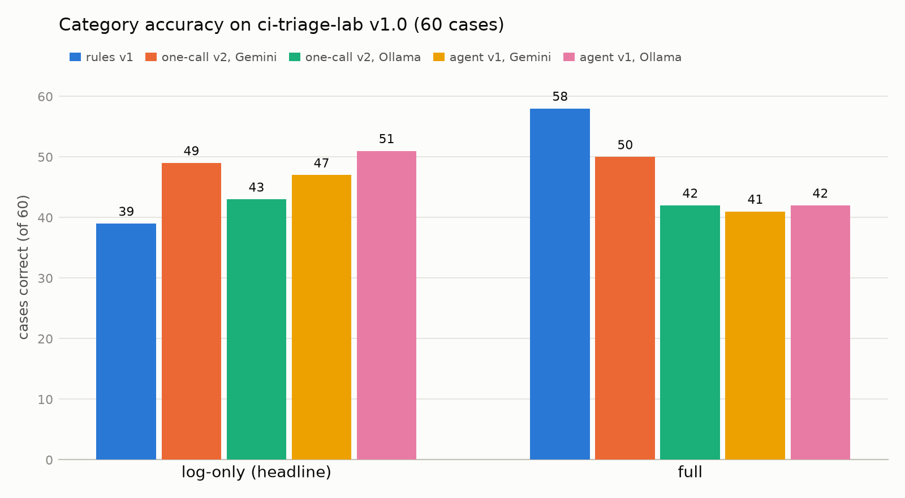

# D7: consolidated results and limitations

This page is built only from the committed reports and the saved run output. No model was called and no
predictor was run for it. Details, per-case tables and settings are in the reports it links.

## The question and the benchmark

**Question.** When a GitHub Actions run fails, can a predictor say *why*? It has to name the failure
category, the failing job and step, the file to change and the fix, and back the diagnosis with verbatim
evidence. We ask whether an LLM, with or without tools, does this better than hand-written rules.

**Benchmark.** [ci-triage-lab](https://github.com/Yassine-Elkesraoui/ci-triage-lab) v1.0, pinned as the
`lab/` submodule at `2b362bc`.
- **Cases.** 60 failures, each injected into one small Python app with a two-job workflow. There are 6
  categories with 10 cases each: real_regression, flaky, dependency, environment, timeout and build.
- **Replay.** It serves the lab's saved GitHub data offline and hides labels, commit messages and later
  history.
- **Scoring.** Every predictor gets the same read-only tools, and the same grader scores it.

**Two modes.**
- **Full**: every tool is available, including `compare` and `get_commit`, which show the diff from the last
  green run.
- **Log-only**: no diff. Files are readable only at the commit under triage. Runs, jobs, logs and history
  stay available.

**Why log-only is the headline.** In full mode the lab's diff is exactly the one injected change, which
makes the file and fix nearly free. The rules baseline scored 58/60 there, near the ceiling. Real triage
often has no usable diff: large PRs, scheduled runs, or alerts without access to the change. So log-only
was registered as the headline condition in D5c (`c374412`), after the rules' full-mode score and before
any LLM run.

## The predictors

| predictor | what it does | reports |
|---|---|---|
| **rules v1** | Hand-written decision table (`predictors/rules.py`), no LLM; about 6 tool calls per case. | `d5b-rules-v1.md`, `d5c-rules-v1-log-only.md` |
| **one-call v2** | One fixed evidence bundle (run, jobs, failure block, workflow file, and the diff in full mode), one schema-constrained model call, and at most one repair call. | `d6a-one-call-v2-gemini.md`, `d6a-one-call-v2-ollama.md` |
| **agent v1** | The same bundle, then up to 8 model turns with the mode's read-only tools, then a `Diagnosis`. | `d6b-agent-v1.md` |

**Models.** Each LLM predictor ran on two models:
- `gemini-3.5-flash-lite`, hosted: thinking level minimal, at most 10 requests per minute, a self-imposed
  cap of 450 attempts per day;
- `qwen3.5:4b` on Ollama, local: weights digest `d8b0f5e9760c`, `think = false`.

Both run at temperature 0 with seed 42. The prompts copy the lab rulebook's six category definitions
verbatim.

## Headline tables

Metrics:
- **Grading.** Grader v2.1 throughout. The D5 and D6a runs were saved with v1 and re-graded offline.
  Category metrics are identical under every grader version.
- **Exact fix** is over the 38 restore-type cases. The 22 remove-type cases need a judge.
- **Grounding** counts cases in which every quote is verbatim in text the predictor saw.
- **Time** is the mean wall time per case. Gemini's includes our pacing. Ollama ran on a laptop with a
  2 GiB GPU.
- **Tokens** are per case, in / out, over every model call.

**Log-only (headline)**

| | rules v1 | one-call, Gemini | one-call, Ollama | agent, Gemini | agent, Ollama |
|---|---|---|---|---|---|
| category accuracy | 39/60 (65.0%) | 49/60 (81.7%) | 43/60 (71.7%) | 47/60 (78.3%) | **51/60 (85.0%)** |
| macro-F1 | 0.593 | 0.783 | 0.683 | 0.781 | **0.843** |
| suspect file correct | 0/60 | 40/60 | 18/60 | **53/60** | 34/60 |
| exact fix, restore-type | 0/38 | 12/38 | 5/38 | **25/38** | 14/38 |
| grounding, cases | **60/60** | 58/60 | 52/60 | 59/60 | 54/60 |
| Brier score (lower is better) | **0.127** | 0.175 | 0.258 | 0.216 | 0.138 |
| tokens per case, in / out | 0 | 1,884 / 251 | 1,842 / 284 | 12,602 / 391 | 36,238 / 607 |
| time per case | **0.03 s** | 6.3 s | 50.6 s | 19.3 s | 155.1 s |

**Full**

| | rules v1 | one-call, Gemini | one-call, Ollama | agent, Gemini | agent, Ollama |
|---|---|---|---|---|---|
| category accuracy | **58/60 (96.7%)** | 50/60 (83.3%) | 42/60 (70.0%) | 41/60 (68.3%) | 42/60 (70.0%) |
| macro-F1 | **0.966** | 0.799 | 0.664 | 0.698 | 0.690 |
| suspect file correct | **60/60** | 59/60 | 46/60 | **60/60** | 47/60 |
| exact fix, restore-type | **38/38** | 33/38 | 30/38 | 36/38 | 30/38 |
| grounding, cases | **60/60** | 59/60 | 53/60 | 59/60 | 53/60 |
| Brier score (lower is better) | **0.080** | 0.160 | 0.273 | 0.313 | 0.264 |
| tokens per case, in / out | 0 | 2,084 / 266 | 2,034 / 285 | 6,769 / 352 | 35,178 / 720 |
| time per case | **0.39 s** | 8.0 s | 51.2 s | 11.3 s | 177.4 s |

**One unanswered case.** The Ollama agent in full mode counts inj-024 as wrong. Ollama could not parse the
model's tool call; that was diagnosed and scored by a rule fixed beforehand (`d6b-agent-v1.md`).



The figure is generated by `scripts/plot_d7.py` from the saved runs.

## Significance

The tests are exact McNemar tests on category correctness over the same 60 cases. The p-value is two-sided
and exact: 2 · P(X ≤ min(b, c)) with X ~ Binomial(b + c, ½), where b and c are the two discordant counts.

| comparison | log-only: only A right / only B right, p | full: only A right / only B right, p |
|---|---|---|
| agent vs one-call, Gemini | 4 / 6, p = 0.754 | 2 / 11, **p = 0.0225** |
| agent vs one-call, Ollama | 9 / 1, **p = 0.0215** | 5 / 5, p = 1.000 |
| agent Gemini vs rules v1 | 13 / 5, p = 0.0963 | 0 / 17, **p = 1.53 × 10⁻⁵** |
| agent Ollama vs rules v1 | 14 / 2, **p = 0.00418** | 0 / 16, **p = 3.05 × 10⁻⁵** |
| agent Gemini vs agent Ollama | 2 / 6, p = 0.289 | 6 / 7, p = 1.000 |

**Multiple tests.** These ten tests were not pre-registered, and no multiplicity correction was planned.
With Bonferroni over the ten (α = 0.005), three results survive: the Ollama agent beats the rules in
log-only mode, and both agents lose to the rules in full mode. The two agent-vs-one-call differences do not
survive. Case lists for every cell are in `d6b-agent-v1.md`.

## Five key findings

1. **Without a diff, the LLMs beat the rules.** The best log-only result is the *small local model with
   tools*: 51/60, against the rules' 39/60. It is the only log-only gain over the rules that survives the
   multiple-test correction. Most of the gain is environment failures (10/10, against the rules' 1/10):
   reading the error text finds them, and the rules' step-name heuristics miss them.
2. **With a diff, simple rules win clearly.** Rules v1 gets 58/60. No LLM predictor gets more than 50, and
   both agents (41 and 42) are significantly worse than the rules. Giving Gemini tools in full mode cost it 9
   cases against its single call.
3. **Tools help find the file and the fix more than the label.** In log-only mode, Gemini with tools names
   the right file in 53 cases instead of 40, and the exact fix in 25 instead of 12. But it often explains a
   Dockerfile, requirements or workflow change correctly and then labels it a code regression. Some label
   changes happen even when the agent calls no tool, so the prompt and the answer format matter too.
4. **Flaky tests are the open problem.** The LLMs get 1–4 of 10. They often *describe* the randomness, the
   race or the timing, and still call it a regression. Run history cannot help here: this replay never shows
   the same commit passing. The rules reach 8/10 only in full mode, where they use the empty-diff signal.
5. **The LLMs are overconfident and cost more.** Wrong answers come at 0.95–1.00 confidence, so the rules
   have the best Brier score in both modes. The agents use 3–20× the tokens of a single call, and the local
   agent takes 2.5–3 minutes per case.

## Pre-registration timeline

Each predictor, prompt and setting was committed ("sealed") before its first evaluation. Changes made
before any run are listed with their reason. Dates and times are git author times (UTC).

| date | commit | step |
|---|---|---|
| 2026-10-23 | `20d77bd` | ci-triage-lab v1.0 pinned as a submodule |
| 2026-11-01 14:58 | `0d80623` | **rules v1 sealed** (D5a) |
| 2026-11-01 15:39 | `84fd7fe` | rules v1 scored, full mode: 58/60 |
| 2026-11-01 16:38 | `c374412` | **log-only mode registered** as the D6 headline (after seeing rules' full-mode near-ceiling score, before any LLM run) |
| 2026-11-01 16:40 | `97737ce` | rules v1 scored, log-only: 39/60 |
| 2026-11-04 | `b7a6b79` | **one-call baseline sealed with prompt v1**. Never run. |
| 2026-11-05 | `ecc9452` | **prompt v2**, before any run. Re-reading v1 against the lab rulebook found two conflicts: v1's build definition, and its tie-break, which went by symptom order instead of by the layer that must change. v2 copies the rulebook's definitions verbatim. |
| 2026-11-06 | `b5bfca9` | one-call v2 scored, Gemini |
| 2026-11-09 | `6833c60` | one-call v2 scored, Ollama (runs of 2026-11-07) |
| 2026-11-09 | `c4adf0e` | **grader v2**, after seeing the D6a results. A read-only audit of the 83 quotes v1 left ungrounded found about a third were re-indentation, line-number prefixes or dropped diff gutters. Fix match by string cannot judge fixes that only delete lines. v2 normalises grounding, adds a quote-rule metric and leaves the 22 remove-type fixes to a judge. |
| 2026-11-09 | `54388b4`, `3f4b83a`, `f5af085` | All saved runs re-graded (category metrics unchanged); the re-grade check fixed; oracle, constant and random sanity runs under v2 |
| 2026-11-09 | `9c13c4b` | **agent v1 sealed** (config, prompt, loop, run plan) |
| 2026-11-12 | `c077fec` | Before any evaluation: a repeated-call guard. An identical tool call returns the earlier result and is not run again. |
| 2026-11-12 | `62c480d` | Before any evaluation: the Gemini adapter keeps repeated tool results structured |
| 2026-11-12 | `bf06738` | **grader v2.1**, before the D6b runs. The agent may quote run history from its own tool output, which v2's "history quote is only a job or step name" rule would have counted as a break. |
| 2026-11-15 | `3ac5ebc` | agent v1 scored, all four runs. The inj-024 scoring rule was fixed before its diagnosis. |

## Limitations

1. **One repository, injected faults.** All 60 failures are single-commit injections into one small app
   with one workflow. Real failures are messier: several causes, large diffs, many jobs.
2. **10 cases per category.** One case moves a category's recall by 0.10. Intervals are wide: the 95%
   Wilson interval on 51/60 is about 74–92%, and on 39/60 about 52–76%.
3. **The rules were written with knowledge of the lab.** Their author read the lab app's workflow file for
   job and step names, and built the lab, so knew its categories and design. No labels or per-case data
   were read before the rules' first score.
4. **The rulebook definitions are benchmark-specific.** For example, "build" means the Docker image failed
   while the test job passed. The LLM prompts copy these definitions verbatim, and other taxonomies would
   score differently.
5. **History cannot reveal flaky tests in this replay.** It never shows a rerun of the same commit, so
   `list_runs` showed only earlier green runs on other commits. A flaky signal that is real in practice is
   absent by construction.
6. **D6b vs D6a is not a clean test of tools.** The agent also has a different prompt (a Tools section, one
   sentence dropped), tool definitions in context, and a free-form answer turn where D6a used a schema.
   Labels changed in 13 cases where the agent called no tool at all.
7. **Grader changes came after seeing results.** Grader v2 followed the D6a audit, and v2.1 the agent
   design. Both are documented, applied to every saved run, and leave category metrics unchanged. They do
   change grounding and fix figures.
8. **The Ollama server version drifted:** 0.40.15 for D6a (read afterwards; the runs did not record it),
   0.40.16 for D6b (recorded). The server logs show the switch on 2026-11-12, between 22:05 and 22:08 UTC,
   before any D6b run. The weights digest is the same. The
   context window also differs by design: 8,192 for D6a, 16,384 for D6b.
9. **Single runs, no variance measured.** Every LLM figure is one run at temperature 0 and seed 42. Hosted
   models are not guaranteed to be deterministic, and re-runs may differ by a few cases.
10. **22 remove-type fixes still need a judge.** Fix match is reported over the 38 restore-type cases only.
11. **Models and free-tier limits change over time.** `gemini-3.5-flash-lite` may be updated or retired.
    The 450-a-day cap was our own limit within a free tier that can change. The results describe these
    models on these dates.
12. **The context estimate was off by up to 47%.** At 3 characters per token, the agent's budget check put
    Ollama prompts at about 10,400 tokens when they were up to 15,321. No prompt was truncated, but the
    check did not enforce what it claimed.
13. **The 60 cases are now spent.** Every design and grading decision since D5b has seen them, so any v2 of
    a predictor or the grader needs a holdout: new lab cases not used for development.
14. **The McNemar tests were not pre-registered.** Ten tests were run, so only the Bonferroni survivors
    above should be read as firm.
15. **Grounding checks presence, not support.** A grounded quote is verbatim in what the predictor saw; it
    is not checked to support the stated root cause.
16. **The Brier score treats a missing answer as calibrated.** The grader gives an invalid_output a
    confidence of 0, so it adds 0 to the Brier sum. This affects one case (inj-024).
17. **Time and cost are setup-specific.** Ollama latency is from a laptop with a 2 GiB GPU, with most of
    the model in system RAM. Gemini's time includes our 10-per-minute pacing.

## How to reproduce

From the repo root, with the lab submodule checked out (`git submodule update --init`):

```powershell
python -m venv .venv; .\.venv\Scripts\activate
pip install -e ".[dev,llm,agent,plot]"
pytest                                                                     # no network, no keys
python -m ci_triage.evaluation.run --predictor rules                      # D5b; add --mode log-only for D5c
python -m ci_triage.evaluation.llm_run --backend gemini --mode log-only   # D6a; then full; --backend ollama; GEMINI_API_KEY for Gemini
python -m ci_triage.evaluation.agent_run --backend gemini --mode log-only # D6b, in the registered plan order
python -m ci_triage.evaluation.regrade                                    # re-grade saved runs offline (writes results/<run>/grader-v2/)
python scripts/plot_d7.py                                                 # this page's figure, from results/
```

**Re-grading.** `regrade` writes the v2 grades. For the D5 and D6a runs, v2.1 gives the same figures as
v2, since those predictors saw no history-tool output of their own. The agent runs were saved with v2.1.

**Settings** (sha256, as printed by every run):

| file | sha256 |
|---|---|
| `configs/one_call_v2.toml` | `74f39cba5f5eb95e018f8d272bb003f0e3f781c1c0a1647585220c7cf07d3290` |
| `prompts/one_call_v2.md` | `a9934294e8caff4fb92a8fc261d0cdef4d5a6693e7c962e9a0d68343a70dc20b` |
| `configs/agent_v1.toml` | `6923a11809bccb7eaad9950e6ff0aca3e9800ed02d0c701a7fdcd918bc3fe70a` |
| `prompts/agent_v1.md` | `87b633e93edbc9bd1126f4bcab6ca81e3f163eeda1fba07b39967d034c358c94` |
| `configs/one_call_v1.toml`, never run | `0f56022b4518ac80c3ad624fa67115d34673d996821a13bb625b7fb382c09299` |
| `prompts/one_call_v1.md`, never run | `e570d417c74e181b9e982eaccad94b48eef399aaa0d491dc59402a1fd66616ee` |

**Environment.** These are the versions the runs used:

| component | version |
|---|---|
| Python | 3.11.9 |
| pydantic | 2.14.1 |
| google-genai | 2.34.0 |
| ollama, Python client | 0.6.3 |
| Ollama server | 0.40.15 for D6a, 0.40.16 for D6b |
| langgraph | 1.2.17 (pinned) |
| langchain-core | 1.7.6 |
| matplotlib, figure only | 3.11.2 |
| OS | Windows 11 |
| lab submodule | `2b362bc7d69862b534cfd102ed5dc9c9e297dccc` |

**Models.** `gemini-3.5-flash-lite`, served under that name on every call. `qwen3.5:4b@d8b0f5e9760c`: GGUF,
Q4_K_M, 4.2B parameters.

**Saved runs.** Per-case records are in `results/` (gitignored). Each holds every model call, tool call,
bundle and grade, so all figures here can be recomputed offline.
